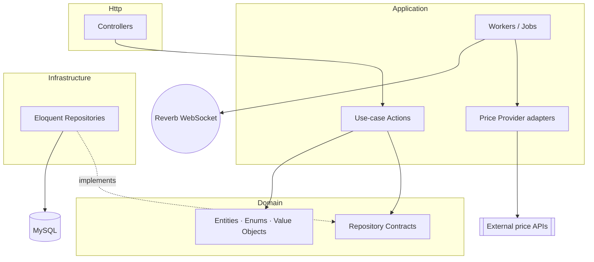
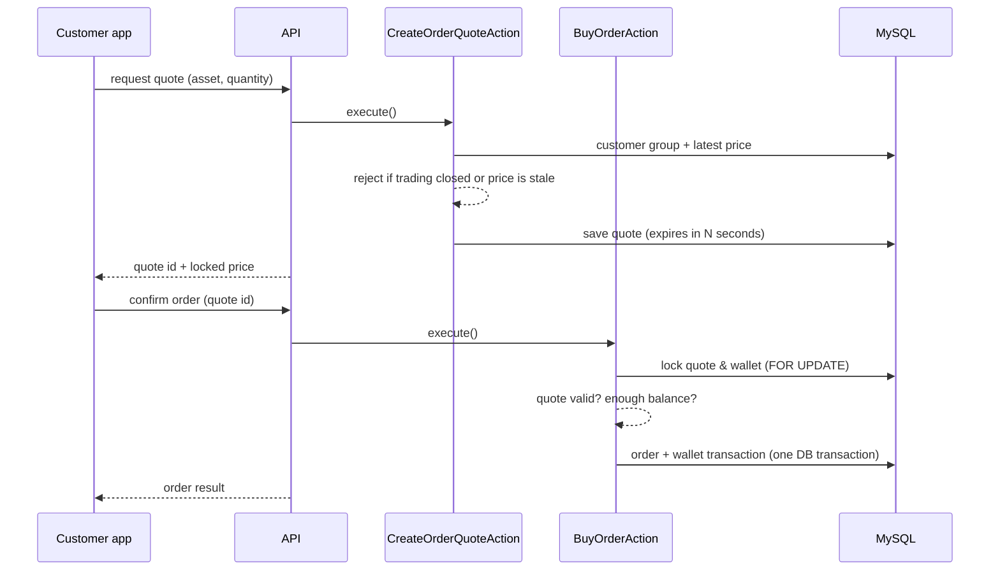
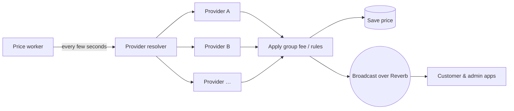

# Online Gold Trading Platform — Architecture Showcase

> This repository is a **showcase**, not the source code.
> The real project is private (client work). Here you'll find the architecture,
> the main flows and a few simplified samples written for this page.

**Stack:** PHP 8.2 · Laravel 12 · Laravel Reverb (WebSocket) · MySQL · Queues · Telegram Bot API · SMS gateway

---

## What it does

A platform where customers buy and sell gold and coins at live market prices.

- **Live pricing** from several external price providers, pushed to clients over WebSocket
- **Price-lock quotes**: a price is locked for a few seconds; the order is placed only against a valid quote
- **Customer groups**: each group has its own price source, fee and open/closed state per asset
- **Wallet**: deposits, withdrawals and a full transaction ledger
- **Treasury**: inventory of physical gold and coins
- **Admin dashboard**, **SMS notifications** and a **Telegram bot** for prices

## Architecture

Layered (DDD-style) — business rules never touch the database directly.

| Layer | Responsibility |
|---|---|
| **Domain** | Entities, enums, value objects and repository **interfaces**. No Laravel, no SQL. |
| **Application** | One Action class per use case (`BuyOrderAction`, `CreateOrderQuoteAction`, …). |
| **Infrastructure** | Eloquent implementations of the Domain interfaces. The only place with queries. |
| **Http** | Thin controllers: validate → call an Action → return JSON. |

## Main flow: buying with a locked price

## Live price pipeline

Each provider is an adapter behind one interface, so adding a new source is one class and one line in the resolver.
If a provider's price gets stale, trading for groups using it is closed automatically instead of selling at an old price.

## Samples

Simplified code written for this showcase (not copied from the project):

- [`samples/PriceProviderInterface.php`](samples/PriceProviderInterface.php): the adapter contract
- [`samples/OrderQuoteRepositoryInterface.php`](samples/OrderQuoteRepositoryInterface.php): a Domain repository contract
- [`samples/CreateOrderQuoteAction.php`](samples/CreateOrderQuoteAction.php): a use-case Action

## Screenshots

See [`screenshots/`](screenshots/).

---

**Erfan Ashrafpour**, Full-Stack Developer (Laravel / Angular) · erfan90000@gmail.com
